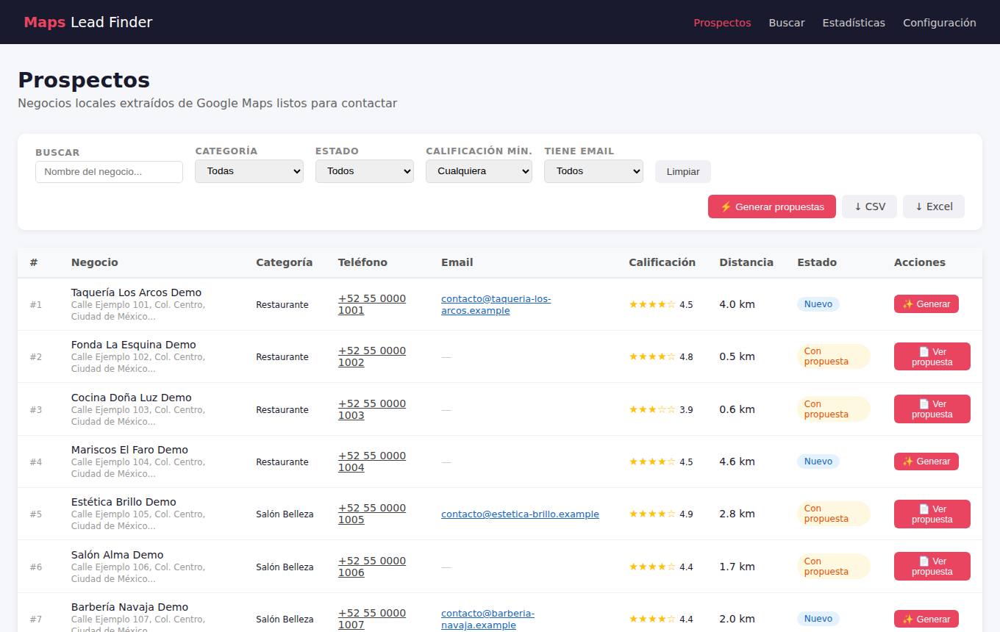
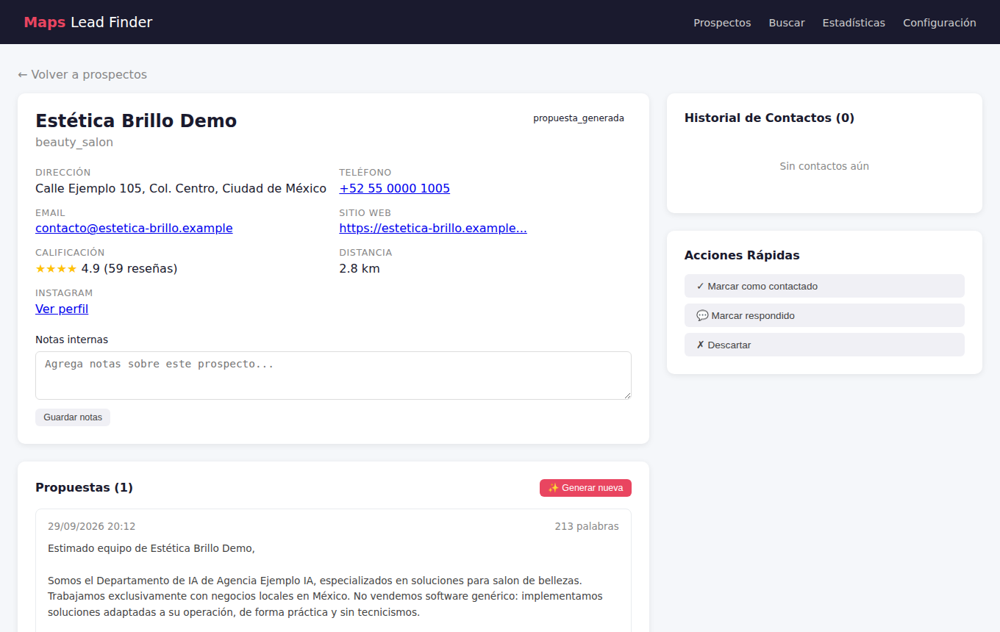
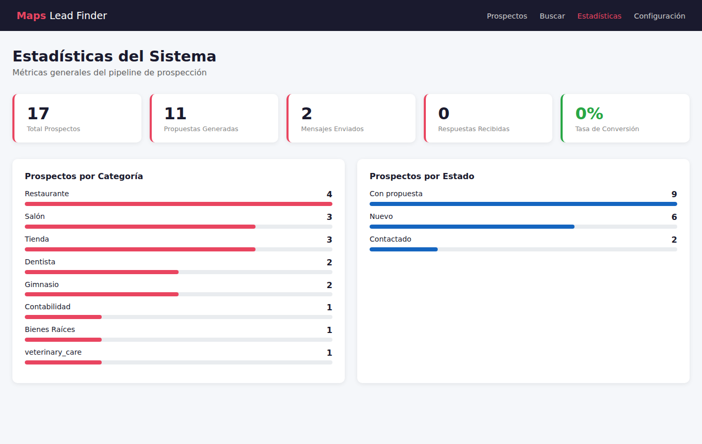
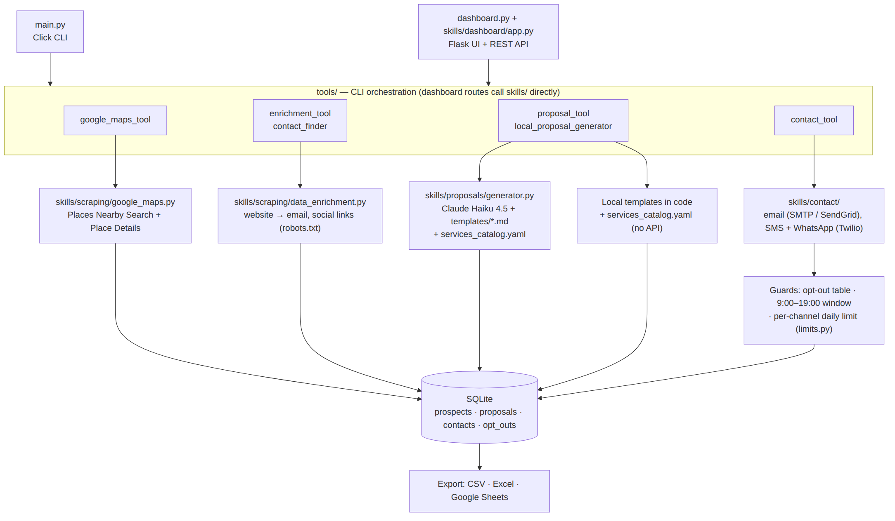
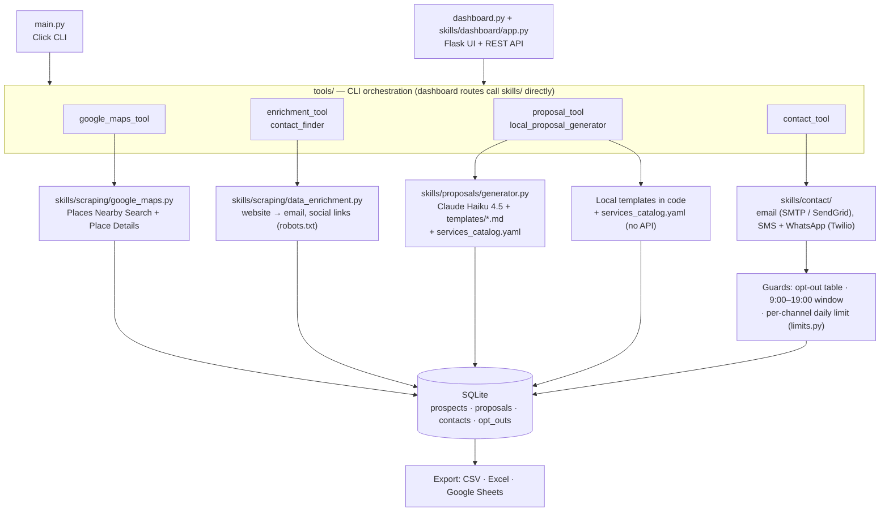

# Maps Lead Finder

A Python CLI and Flask dashboard for small agencies. It finds local businesses around a point through the Google Places API, writes a tailored Spanish sales proposal for each one (with Claude or with built-in templates), and sends it by email, SMS or WhatsApp with opt-out, time-window and daily-limit guards.

  

## What it does

Prospecting local businesses by hand means three separate jobs: building a list from Google Maps, finding a contact for each business, and writing a message that doesn't read like spam. This project runs all three from one SQLite database:

1. **Build the list.** It searches Google Places by category within a radius and stores each business with its rating, reviews and distance.
2. **Find contacts.** It visits each business's website to find an email and social links, respecting robots.txt.
3. **Write the proposal.** For each prospect it produces an email, a WhatsApp message and a phone script. They pick services from a catalog based on what the business lacks, for example a website or social media.
4. **Send.** Sending runs through guards: an opt-out list, a contact-hours window and a per-channel daily limit.

The agency's name and contact details come from environment variables, and the proposal copy is written for Mexican businesses.

## Demo

Screenshots of the dashboard running on a seeded database of **fictional** businesses (every name ends in "Demo" and uses `.example` domains). The proposals shown were produced by the local template generator with `AGENCY_NAME=Agencia Ejemplo IA`.

**Prospects list** — filters, batch generation and CSV/Excel export:



**Prospect detail** — business data, contact history and the generated proposal:



**Statistics** — pipeline counts by category and status:



CLI surface (`python main.py --help`):

```text
Commands:
  enrich           Visita sitios web de prospectos para extraer emails y...
  export           Exporta prospectos a CSV (default) o directamente a un...
  find-emails      Busca emails faltantes visitando sitios web con...
  fix-whatsapp     Normaliza teléfonos a formato E.164 (+52XXXXXXXXXX) y...
  generate         Genera propuestas comerciales con IA para prospectos.
  generate-local   Genera propuestas de email y WhatsApp sin API externa...
  init-db          Inicializa la base de datos SQLite y crea todas las...
  regenerate       Elimina TODAS las propuestas y las regenera con los...
  scrape           Busca negocios locales en Google Maps y los guarda en...
  send             Envía una propuesta específica por el canal indicado.
  send-batch       Envío masivo de propuestas pendientes.
  stats            Muestra estadísticas del sistema de prospección.
  update-whatsapp  Actualiza los mensajes de WhatsApp de todas las...
```

## Architecture

Module-by-module detail, the data model and the dashboard API are in [docs/ARCHITECTURE.md](docs/ARCHITECTURE.md).





- **Scrape.** `google_maps.py` runs a Nearby Search for each category (up to 3 pages of 20 results). It then calls Place Details for each result to get the phone, website, hours, price level, editorial summary and up to three review snippets. Distance is computed with the haversine formula, and new rows are deduplicated on `place_id`.
- **Enrich.** `data_enrichment.py` fetches the homepage, and the contact page if needed, and extracts emails, Facebook, Instagram, LinkedIn and WhatsApp links. It filters out system addresses and prefers `contacto@`/`info@`-style emails. `find-emails` also tries 13 common contact paths such as `/contacto` and `/nosotros`. Every URL is checked against robots.txt, and sites with invalid TLS certificates are skipped.
- **Propose.** `service_catalog.py` scores the 17 catalog services: 3 points when a service's `best_for` list includes the business category, 1 otherwise. "Website" jumps to 10 when the business has none, and "social media" jumps to 10 when it has no Instagram or Facebook. The top services then go to one of two generators:
  - **`generator.py`** calls Claude Haiku 4.5 twice, once for the email and once for the WhatsApp message. The prompt includes a per-category Markdown template, the Google editorial summary and review snippets. Over-long output is cut back at the last full sentence, then the agency's contact details are filled in.
  - **`local_proposal_generator.py`** builds the email, the WhatsApp message and a phone script from hand-written copy, with no API call.
- **Send.** Every sender checks, in order: the `opt_outs` table, the 9:00–19:00 window (America/Mexico_City) and a per-channel daily limit (50 by default). The limit counts today's successful rows in the `contacts` table. Senders then append an opt-out footer, log the attempt to `contacts`, and mark the prospect as contacted.
- **Review and export.** The Flask dashboard lists and filters prospects, edits and sends proposals, and shows statistics. `export` writes a CSV, and optionally a Google Sheet through a service account. The dashboard also exports Excel.

## Tech stack

- **Language / runtime:** Python 3.10+
- **Data sources:** Google Places API through `googlemaps` (Nearby Search, Place Details); `requests` + `beautifulsoup4` + `lxml` for websites, `urllib.robotparser` for robots.txt
- **LLM:** Anthropic Claude (`claude-haiku-4-5-20251001`) through the `anthropic` SDK
- **Storage:** SQLite through Flask-SQLAlchemy (prospects, proposals, contacts, opt-outs, plus a key/value config table)
- **Web UI:** Flask 3 with server-rendered Jinja templates and vanilla JS against a JSON API
- **Outreach:** `smtplib` or SendGrid for email; Twilio for SMS and WhatsApp
- **Validation / config:** Pydantic models for scraped data, `python-dotenv` + YAML settings
- **CLI / export:** Click, pandas + openpyxl (CSV/Excel), gspread + google-auth (Sheets)
- **Tests:** pytest (77 tests: scraping, proposals, contact guards, integration against in-memory SQLite)

## Key design decisions

**Official Places API over browser scraping** — Businesses come from the Google Places API through the `googlemaps` client, not from scraping maps.google.com with a headless browser. The API returns structured phone, website, rating and review data and doesn't break when the page layout changes. It also stays within Google's terms. The cost is money and reach:
- Every result triggers a billed Place Details call.
- Each category is capped at 60 results (3 pages).
- The client uses the Places API (Legacy), which new Google Cloud projects can no longer enable.

**Two proposal generators behind one data model** — `generate` uses Claude and `generate-local` uses deterministic templates. Both write to the same `proposals` table, so the dashboard, export and senders don't care which one ran.
- The Claude path personalizes from the business's Google summary and reviews, and asks for 150–200 words.
- The local path costs nothing and runs offline. It picks one of three copy variants from a hash of the business name, so the same business always gets the same variant.

The trade-off is two sets of copy to maintain, and the local templates don't respect the word limit (see Limitations).

**Rule-based service selection instead of letting the model choose** — Which 2–3 services a proposal pitches is decided in code (`ServiceCatalog.get_services_for_category`): catalog `best_for` tags, plus hard overrides when a business has no website or no social media. Only the wording is left to the model. This keeps offers consistent and auditable across hundreds of prospects, and lets the local generator make the same choice without an API call. It cannot pick up needs that aren't encoded in the catalog.

**Guards inside each sender, with the daily limit counted in the database** — The opt-out, contact-hours and daily-limit checks live in the email, SMS and WhatsApp senders, not in the CLI or dashboard. That way every path that sends (single send, batch, dashboard button) goes through them. The daily limit counts today's successful sends in `contacts` rather than keeping a counter in memory, because each send creates a new sender object and the CLI and dashboard can run at the same time. The cost is one extra query per send.

**SQLite and a local-only dashboard** — One file database, with the Flask app bound to `127.0.0.1`. The alternative was a hosted database with an authenticated web app. The project targets one operator on one machine, so this keeps setup to `pip install` and an `.env` file. The trade-off is that there is no authentication, no multi-user access, and background scraping runs in a thread inside the Flask process.

## Results

Measured in this repository:

- **Tests:** 77 tests pass (`pytest`) in under 2 s on a clean virtualenv built from `requirements.txt`.
- **Local generator output:** measured over all 14 configured categories, with and without website/social media, and 3 business names each (168 proposals):
  - emails run 205–304 words (median 264);
  - WhatsApp messages run 179–203 words (median 194).
- **API calls per search:** 1 Nearby Search call per results page plus 1 Place Details call per result. The worst case is 3 + 60 calls per category.
- [TODO: metric — prospects found and contact-data coverage (email / WhatsApp) for a real search radius]
- [TODO: metric — reply rate by channel from a real campaign]
- [TODO: metric — Claude cost per proposal (two Haiku calls per prospect)]

## Getting started

**Prerequisites**

- Python 3.10+
- A Google Cloud project with **Places API (Legacy)** enabled. New projects can't enable it since March 2025 (see Limitations).
- An Anthropic API key, for `generate` only. `generate-local` needs no key.
- Optional, for sending: SMTP credentials or a SendGrid key, and a Twilio account for SMS and WhatsApp.

**Install**

```bash
git clone https://github.com/hectorgarciaalmaraz/maps-lead-finder.git
cd maps-lead-finder
python -m venv .venv
source .venv/bin/activate          # Windows: .venv\Scripts\activate
pip install -r requirements.txt
pip install -e .                   # optional: adds the maps-lead-finder commands
```

**Configure**

```bash
cp config/.env.example config/.env   # or .env in the project root
```

Fill in `GOOGLE_MAPS_API_KEY` and the `AGENCY_*` values (name, phone, email and social links used in proposals). Add `ANTHROPIC_API_KEY` and the SMTP/SendGrid/Twilio values if you use those features. Search defaults, categories, the model, word limits, the contact window and the daily limit live in `config/settings.yaml`. Services live in `config/services_catalog.yaml`; replace them with your own.

**Run**

```bash
python main.py init-db
python main.py scrape --lat 19.4326 --lng -99.1332 --radius 3 -c restaurant -c gym
python main.py find-emails --limit 50           # extra pass for missing emails
python main.py generate-local                   # templates, no API
python main.py generate --all-pending           # or: Claude
python main.py send-batch --all-ready --channel email --dry-run
python main.py export --only-with-proposals     # CSV
python dashboard.py                             # http://127.0.0.1:5000
pytest
```

Drop `--dry-run` only once your sender credentials are set and you have checked that the messages comply with the rules for your channel and country.

## Project structure

```text
maps-lead-finder/
├── main.py              Click CLI (scrape, enrich, generate, send, export, stats, maintenance)
├── dashboard.py         starts the Flask dashboard
├── config/              settings.yaml, services_catalog.yaml, .env.example, AppConfig loader
├── skills/
│   ├── scraping/        Google Places client, website enrichment, Pydantic models
│   ├── proposals/       Claude generator, service catalog, per-category templates
│   ├── contact/         email / SMS / WhatsApp senders, daily-limit helper
│   └── dashboard/       Flask app factory, ORM models, JSON API
├── tools/               CLI orchestration: scraping, enrichment, email finder, generators, sending
├── templates/           Jinja pages for the dashboard
├── tests/               pytest suite (unit + integration on in-memory SQLite)
├── docs/
│   ├── ARCHITECTURE.md  module responsibilities, data model, data flow, extension points
│   └── images/          architecture diagram and dashboard screenshots
├── CLAUDE.md            project notes for Claude Code
├── requirements.txt     pinned dependencies
├── pyproject.toml       black, ruff and pytest settings
└── setup.py             editable install with console entry points
```

## Limitations

- **Places API (Legacy) only.** The `googlemaps` client calls the legacy Nearby Search and Place Details endpoints. Google stopped offering Places API (Legacy) to new Cloud projects on 1 March 2025, so a fresh project cannot run `scrape` until the scraper is migrated to Places API (New).
- **Search coverage and cost.** Each category returns at most 60 places (3 pages). Place Details is billed for every result, including businesses already in the database, because deduplication happens only at save time.
- **Unsolicited outreach rules.** The guards (opt-out, hours, daily limit) are not a compliance layer. Consent and anti-spam rules for email, SMS and WhatsApp in your country are your responsibility.
- **WhatsApp templates.** WhatsApp Business (through Twilio) only allows free-form messages inside a 24-hour window opened by the customer. First contact requires a pre-approved template, which this code does not use, so cold WhatsApp sends will fail.
- **Instagram and LinkedIn are manual.** Those channels are only logged for manual follow-up.
- **Opt-outs are manual.** The email footer asks recipients to reply "BAJA", but nothing reads the inbox. Opt-outs have to be registered through the dashboard or the `/api/optout` endpoint. The email check lowercases the address, but the endpoint stores it as entered.
- **Word limits only on the Claude path.** That path asks for 150–200 words but only cuts output above 220, and doesn't pad short output. The local generator ignores the configured limits: its emails measure 205–304 words and its WhatsApp messages 179–203.
- **Unsourced figures in the copy.** The local templates include industry statistics (for example "el 75% de esas ausencias…") with no source. Verify or remove them before sending.
- **Dashboard configuration page is not used.** Agency details edited on that page are saved to the database, but both generators read `AGENCY_*` from the environment.
- **No authentication.** The dashboard binds to `127.0.0.1` by default and must not be exposed publicly. Scraping started from the dashboard runs in a background thread inside the Flask process.
- **Browser-like User-Agent.** Website enrichment sends a desktop-browser User-Agent string rather than identifying itself as a bot.
- **Mexico-specific defaults.**
  - phone normalization assumes +52;
  - the contact window uses America/Mexico_City;
  - the proposal copy is Spanish for Mexican businesses.
- **Unused notification helper.** `tools/notification_tool.py` (alerts to the operator) is not called anywhere yet.
- **Retired default model.** The original default model (Claude 3.5 Haiku) was retired in February 2026. It is now `claude-haiku-4-5-20251001`; update `config/settings.yaml` when that model is retired too.
